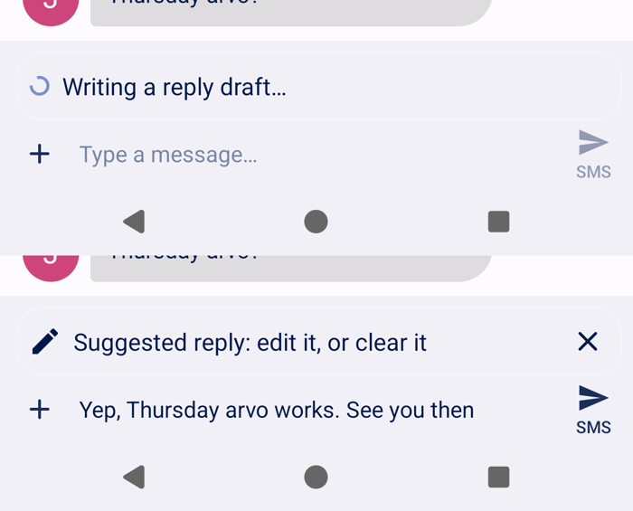
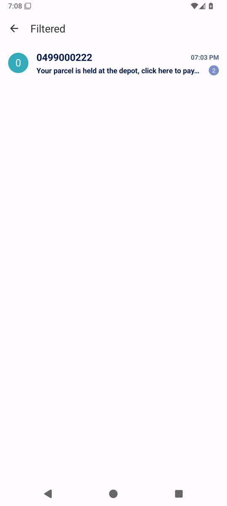

# Ahoy Messages


> [!WARNING]
> **Beta, and vibe-coded.** This is a personal project: a fork of [Fossify Messages](https://github.com/FossifyOrg/Messages)
> with an AI add-on, built with Claude Code for one tradie's phone and home server. It has been tested on an
> Android emulator and is being trialled on a Pixel running GrapheneOS, but it hasn't had a proper code
> review. It is **not** made or endorsed by Fossify; please don't report its bugs to them.

Ahoy Messages is an SMS app for a small business owner whose work and personal texts arrive on the same phone.
It is Fossify Messages (a plain, private, open-source SMS app) plus a connection to **your own server**, which
runs a small local AI model to:

- **Filter spam and ads.** Scam texts, promotions and wrong-number openers from strangers go to a
  *Filtered* list without a notification. Texts from your contacts always come straight through, and one-time
  codes are never filtered.
- **Flag work.** Quote requests and texts from customers are pushed to [ntfy](https://ntfy.sh), so they reach
  your other devices with a short summary.
- **Draft replies.** A suggested reply is written into the reply box, with a spinner while it's on its way.
  It is never sent for you: edit it, or clear it with one tap.
- **Learn your style.** Send a whole conversation for review and the server keeps notes on that person and
  examples of how you write, so later drafts sound like you. One tap forgets it again.

Your texts never go to a cloud AI service. The phone talks only to your server, and every request is
encrypted with a key that only the phone and the server have, so it's safe to put the server behind a proxy
such as Cloudflare. If the server can't be reached, the app behaves like a normal SMS app.

It works on de-Googled phones: no Google Play Services, no Play Integrity, no Firebase.

<div align="center">


</div>

## How it fits together

```
 Phone (Ahoy Messages)                  Your server (Docker)
 ─────────────────────                  ─────────────────────────────────────────
 SMS arrives ──► encrypted POST ──────► sms-triage ──► Ollama (qwen3:4b on the GPU)
                 (through your                │
                  reverse proxy)              ├──► ntfy: "Quote request (text)"
 ◄── filtered? draft coming? ◄────────────────┘
 Draft request ──────────────────────► writes a reply in your style
 ◄── suggested reply into the box ◄───
```

The same server image can also sort your **email** (`mail-triage`): it watches any IMAP inbox and alerts
you to quote requests and customer emails, using the same model. Both services post to the same two
[ntfy](https://ntfy.sh) topics with priorities, so you can build your own alert setups on top: different
sounds per topic, a desk display that keeps quotes on screen, Home Assistant automations. See the
[server guide](server/README.md) for email setup, the alert topics and priorities, and every setting.

## What the server needs

- **Docker** with Docker Compose.
- **[Ollama](https://ollama.com)**, ideally with an NVIDIA GPU. It's developed on an **NVIDIA T1000 (4 GB)**,
  which fits the model it uses, **`qwen3:4b`**, with thinking switched off and a 4096-token context. Other
  small models can work too; set `OLLAMA_MODEL`. CPU-only works, but expect slow drafts.
- **[ntfy](https://ntfy.sh)** (self-hosted or ntfy.sh) for the alerts, with a token that can publish to the
  `ahoy-quote` and `ahoy-webmsg` topics.
- **A reverse proxy with HTTPS**, so the phone can reach the server from anywhere. There's an Apache example
  in `server/apache-sms.example.conf`.
- For email sorting only: any IMAP email account (Gmail, Fastmail, your own server; Proton Mail through
  Proton Mail Bridge), and optionally a CardDAV address book such as Radicale, so mail from your contacts
  always comes through.

## Setting up the server

1. Copy the `server` folder to your server.
2. Make your config from the examples:
   ```bash
   cp docker-compose.example.yml docker-compose.yml
   cp .env.example .env
   ```
3. Make the shared key, put it in `.env` as `SMS_SHARED_KEY`, and fill in the rest of `.env`:
   ```bash
   openssl rand -base64 32
   ```
4. Point `OLLAMA_URL` in `docker-compose.yml` at your Ollama and pull the model:
   ```bash
   docker exec ollama ollama pull qwen3:4b
   ```
5. Optional but recommended: write your own prompts (your business, your area, how you write) in a
   `prompts` folder. See [`server/prompts.example`](server/prompts.example/README.md). Without them the
   server uses generic prompts for "a small local business".
6. Start it:
   ```bash
   docker compose up -d --build
   ```
7. Put it behind your reverse proxy at a hostname like `sms.example.com`, letting through only `POST` to
   `/sms/incoming`, `/sms/draft`, `/sms/review` and `/sms/forget`.

`GET /health` on the container answers `ok`, for monitoring (for example an Uptime Kuma HTTP check).
`server/sms_client.py` is a command-line client for testing the server before setting up the phone.

## Setting up the phone

1. Install the APK from [Releases](../../releases), or add this repository's URL to
   [Obtainium](https://github.com/ImranR98/Obtainium) to get updates automatically.
2. On GrapheneOS, allow the app's **Network** permission (Settings → Apps → Ahoy Messages → Permissions).
   It needs it to reach your server.
3. Open the app, then ⋮ → **Ahoy server**. Enter your server address (`https://sms.example.com`) and the
   shared key, then tap **Save and test**. It should say *Connected*.
4. Make it your default SMS app when you're ready. You can try it alongside another SMS app first.

In a conversation, ⋮ has **Draft a reply**, **Send for style review**, **Forget review**, and
**Move to Filtered** / **Not spam**. The main menu has **Show filtered (spam and ads)**.

## Known limits

- **Beta.** Expect rough edges.
- Picture messages (MMS) aren't sorted or drafted for, only SMS.
- Drafts and reviews only work in one-to-one conversations.
- The shared key is stored in the app's private storage without extra encryption.
- The server keeps notes from reviewed conversations and your example texts on disk (`/state`). Incoming
  texts and drafts are not stored, and message text is never logged.

## Building from source

Android Studio (or JDK 21 and the Android SDK), then:

```bash
./gradlew :app:assembleFossDebug
```

Release builds are signed using a `keystore.properties` file in the project root (see
`keystore.properties_sample`), which is never committed.

## Changes from Fossify Messages

Forked from Fossify Messages 1.10.2 (tag `1.10.2`) in November 2026. Changes:

- New: everything in `app/src/main/kotlin/org/fossify/messages/ahoy/`, the settings screen layout,
  `ahoy_strings.xml`, and the `server/` folder.
- Changed: the incoming SMS receiver (asks the server before notifying), the main and archived conversation
  screens (the Filtered list), the conversation screen (draft bar and menu), menus, the manifest (internet
  permission, app name), the launcher icon, version numbering and the package name
  (`au.com.ahoyhandyman.messages`).
- Removed: Fossify's warning about unofficial builds, the About screen (it points to Fossify's support and
  donation pages), and Fossify's CI, store listings and issue templates.

## License

GPL-3.0, the same as Fossify Messages: see [LICENSE](LICENSE). All credit for the messaging app itself goes to
[Fossify](https://www.fossify.org) and the Simple Mobile Tools contributors before them. If you want a
private SMS app without the AI parts, use [Fossify Messages](https://github.com/FossifyOrg/Messages).
